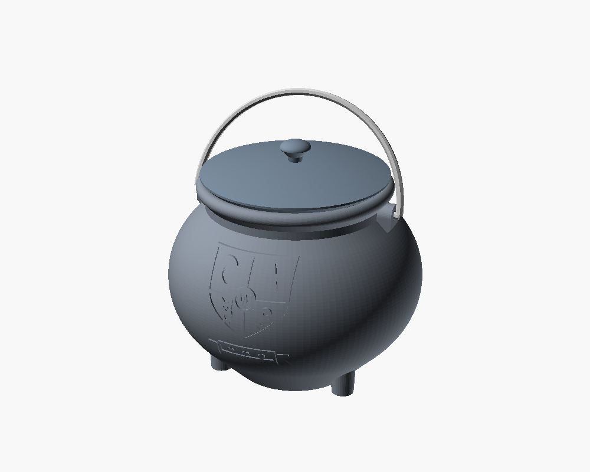

# 3D-model

A library of parametric, 3D-printable models. Every model is written in
[OpenSCAD](https://openscad.org) with all key dimensions as variables at the
top of the source file; STLs and preview images are generated from the source
by a script, so they can always be reproduced.

## Models

| Model | Description | |
|---|---|---|
| [hexenkessel](models/hexenkessel/) | Witch's cauldron (150 mm) with removable lid, swinging bail handle and an embossed, swappable crest. Prints without supports. |  |

## Layout

```
models/<model-name>/
  src/          parametric source (.scad) and assets (e.g. .svg)
  stl/          exported STL files, oriented for printing
  preview/      PNG renders of each part
  export.conf   list of parts/views the export script builds
  README.md     description, parts list, print settings
scripts/
  export_all.sh render all STLs + previews, then verify the STLs
  check_stl.py  watertight / single body / build plate / overhang check
  shade_stl.py  shaded close-up render (used for relief previews)
```

## Building

```sh
# requirements: OpenSCAD >= 2021.01, Python 3
pip install -r scripts/requirements.txt

scripts/export_all.sh              # all models
scripts/export_all.sh hexenkessel  # a single model
```

The script fails if a part is not a clean solid. `check_stl.py` verifies for
every STL that it is watertight (2-manifold), consistently wound, a single
body, sits on the bed, fits a 256 x 256 x 256 mm build volume and has no
unsupported overhang steeper than 45 degrees.

## Adding a model

1. Create `models/<name>/src/<name>.scad` with the parameters at the top and a
   `part` variable that selects which part is built.
2. List the parts in `models/<name>/export.conf` (see the hexenkessel one).
3. Run `scripts/export_all.sh <name>`, write `models/<name>/README.md` and add
   a row to the table above.
