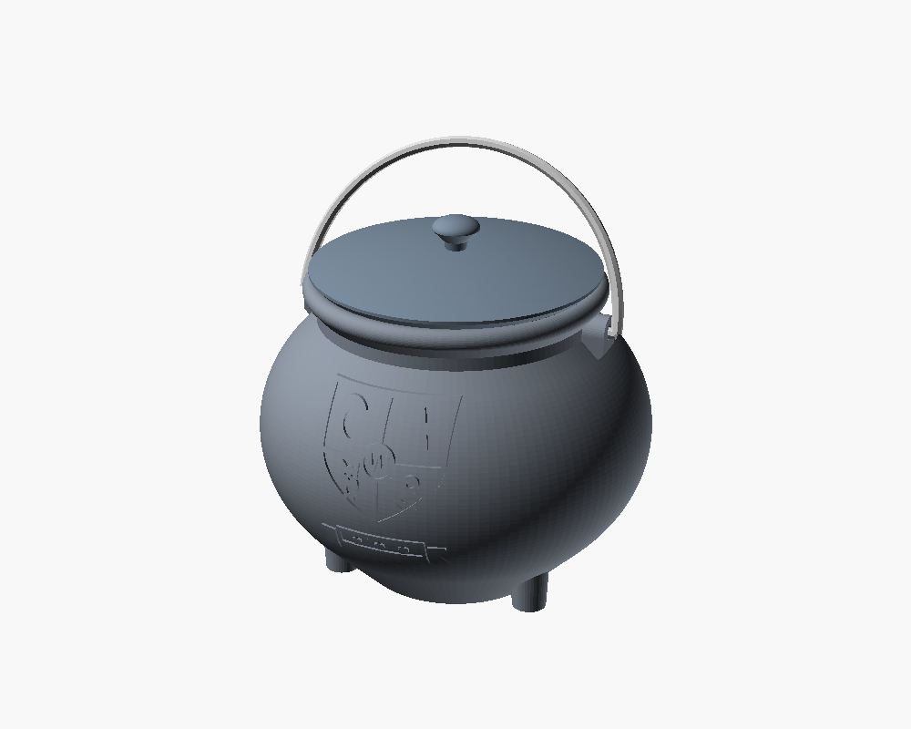
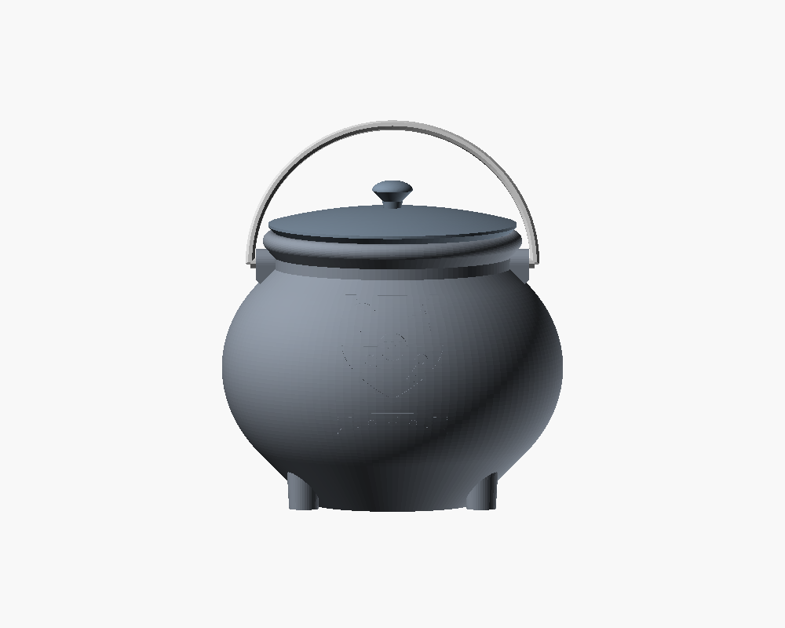
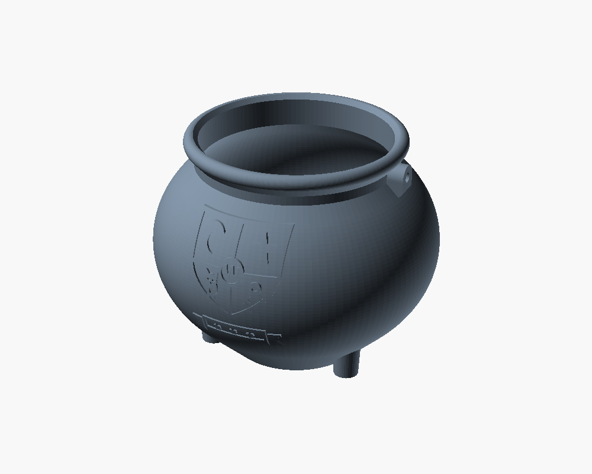
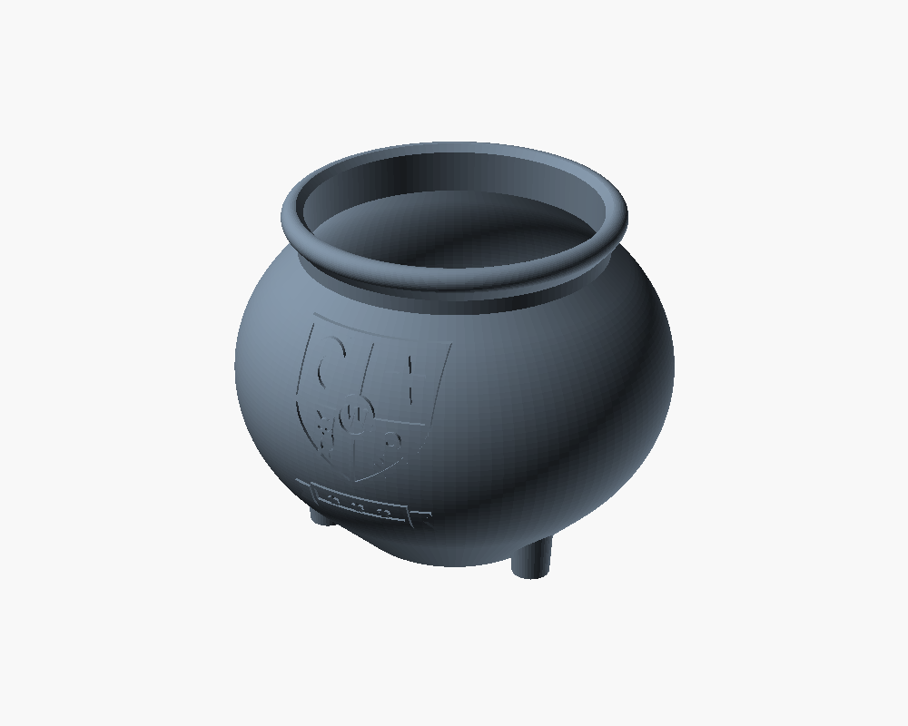
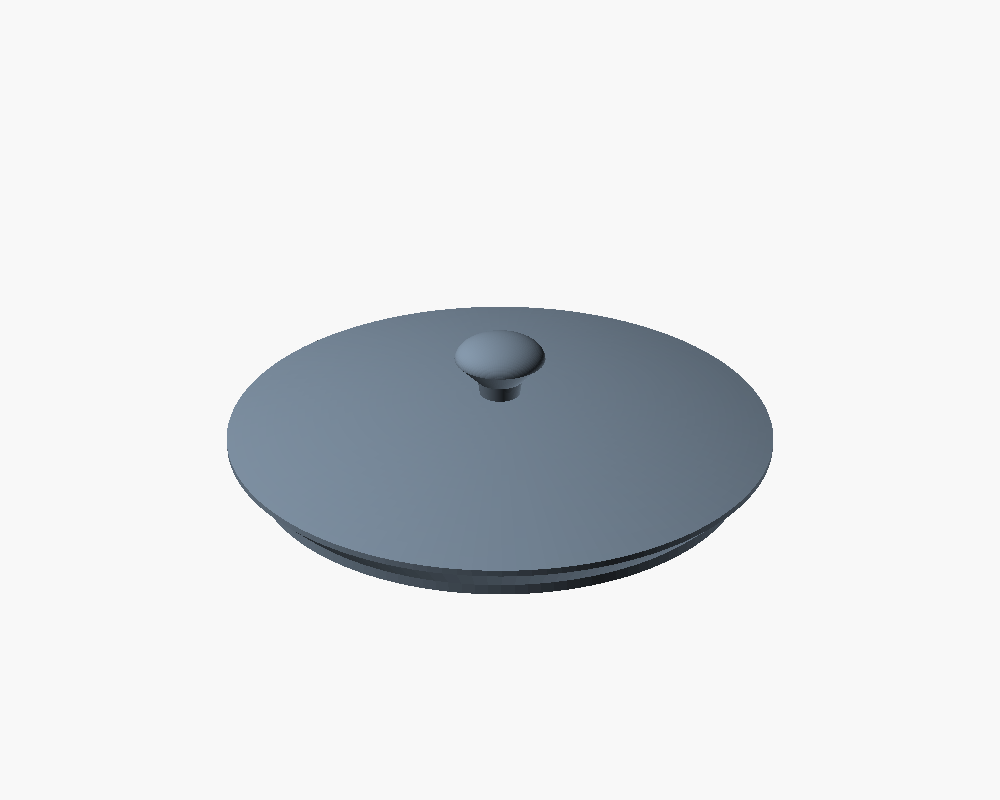
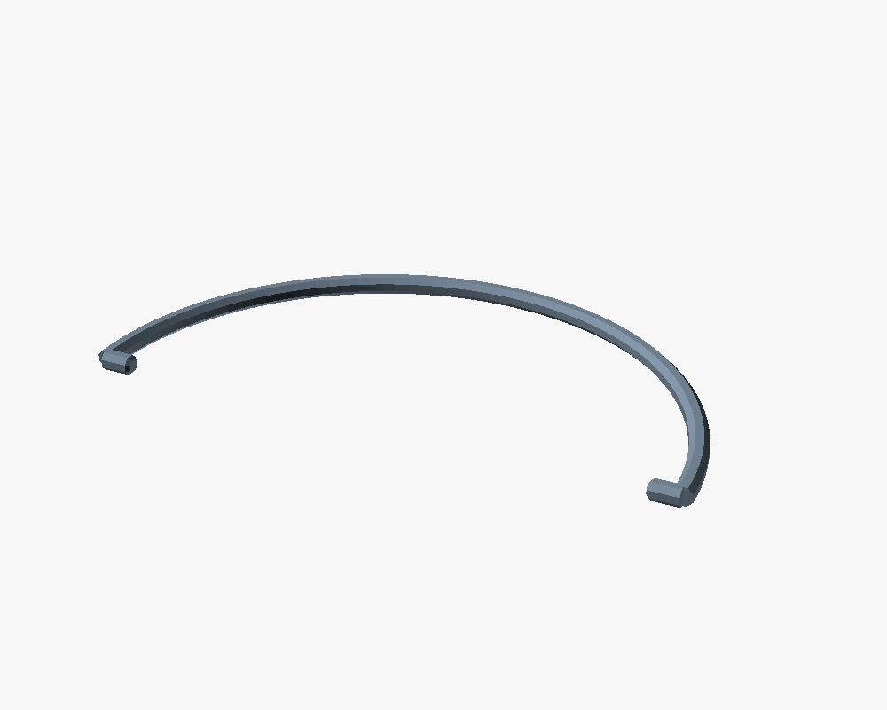

# Hexenkessel – witch's cauldron

Round-bellied cauldron with a rolled rim, three stubby legs, a removable
domed lid, a swinging bail handle and an embossed wizard-school crest on the
front. Designed for a Bambu Lab printer (256 x 256 mm plate), PLA, 0.4 mm
nozzle. **Every part prints without supports.**

| Assembled | Front | Crest relief |
|---|---|---|
|  |  |  |

## Parts

| File | Part | Size (X x Y x Z) | Print orientation |
|---|---|---|---|
| `stl/kessel_mit_henkel.stl` | body **with** handle lugs | 150 x 151 x 120 mm | upright, as exported |
| `stl/kessel_ohne_henkel.stl` | body **without** lugs (smooth sides) | 150 x 151 x 120 mm | upright, as exported |
| `stl/deckel.stl` | lid with knob | Ø 109.2 x 27.5 mm | flat underside on the bed, knob up |
| `stl/henkel.stl` | bail handle with snap-in pins | 129 x 67 x 4 mm | lying flat |

| Variant | Files to print |
|---|---|
| Cauldron with handle | `kessel_mit_henkel.stl` + `henkel.stl` + `deckel.stl` |
| Cauldron without handle | `kessel_ohne_henkel.stl` + `deckel.stl` |

The lid is optional in both variants.

| | | | |
|---|---|---|---|
|  |  |  |  |
| kessel_mit_henkel | kessel_ohne_henkel | deckel | henkel |

## Print settings

| Setting | Value |
|---|---|
| Material / nozzle | PLA, 0.4 mm |
| Layer height | 0.2 mm |
| Walls | 3 |
| Infill | 15 % |
| Supports | **none** |
| Brim | only if needed – most useful for the thin handle (`henkel.stl`) |

Notes

- The body wall is 2.4 mm, i.e. it is solid perimeters with 3 walls.
- The lid is a solid lens shape (flat underside, domed top) so that it can
  print without supports; with 15 % infill it weighs roughly 35–40 g.
- Seam: "aligned" or "back" keeps the seam away from the crest.

## Assembly of the handle

1. Hold the handle above the cauldron with the two pins pointing at the lugs.
2. Put one pin into its lug hole.
3. Gently spread the handle (about 4 mm) and let the second pin snap into the
   other lug. PLA is flexible enough for this; warm the handle in your hands
   if the room is cold.
4. The handle now swings freely from side to side and rests on the cauldron's
   shoulder. Pin/hole clearance is 0.35 mm (`hinge_clear`); if your printer
   prints tight, increase it to 0.4 and re-export.

## Design notes

- Belly: an ellipse, limited to the range where its slope is at most 45°, and
  continued with 45° cones down to the flat bottom and up to the neck. That is
  what makes the body printable upright without supports, inside and outside.
- The three legs are flush with the flat bottom, so the first layer is the
  bottom disc plus three feet – no bridging under the cauldron.
- Rim: a rolled bead whose underside is closed at 45°; the inside has a 45°
  conical seat. The lid's matching cone rests on it and a short plug centres
  it in the neck with 0.3 mm radial clearance (`clearance`).
- Lugs: the pivot holes are teardrop-shaped (45° roof).
- Crest: 1.0 mm relief that follows the curved surface (constant height
  measured from the wall). The undersides of the raised shapes are drafted in
  five micro-steps, each narrower than one extrusion line; the draft
  automatically gets longer where the wall itself leans outwards (visible as
  small ramps below the shapes, mostly at the ribbon). For that reason the
  emblem sits 8 mm above the widest point (`emblem_z`).

## Customising

All parameters are at the top of [`src/hexenkessel.scad`](src/hexenkessel.scad):
`body_d`, `body_h`, `wall`, `base_d`, `neck_d`, `clearance`, `hinge_clear`,
`handle_t`, `emblem_h`, `emblem_relief`, ... After changing something run
`scripts/export_all.sh hexenkessel` from the repository root; it re-renders
all STLs and previews and checks them.

### Emblem

The emblem is a separate module in [`src/emblem.scad`](src/emblem.scad).

- **Built-in crest** (default): an original design, free to use – a shield
  quartered with crescent moon, star, owl and key, the letter "W" in a centre
  medallion and a ribbon banner below. `crest_letter` changes the letter,
  `crest_motto` puts a short text on the ribbon instead of the three stars.
- **Your own logo**: replace `src/emblem.svg` with your file and set
  `emblem_use_svg = true` in `hexenkessel.scad` (or pass
  `-D emblem_use_svg=true` to OpenSCAD). The SVG is centred and scaled to
  `emblem_h` (60 mm) tall. Use filled shapes only (convert strokes and text
  to paths), keep details ≥ 1 mm and the width ≤ `emblem_max_w` (56 mm).
  The bundled `emblem.svg` is just a placeholder (star in a diamond).
- `emblem_on = false` gives a plain cauldron.


## Verification

Output of `scripts/check_stl.py` for the committed files – all four are
watertight single solids, fit the plate and have no unsupported overhang
above 45°. In the assembled position the lid and handle do not intersect the
body, and the handle swings through the full 180°.

```
OK   kessel_mit_henkel.stl     150.0 x  151.0 x  120.0 mm   54266 tris  vol  155.6 cm3  micro-ledges 335.6 mm2  unsupported  0.0 mm2
OK   kessel_ohne_henkel.stl    150.0 x  151.0 x  120.0 mm   53734 tris  vol  153.6 cm3  micro-ledges 335.6 mm2  unsupported  0.0 mm2
OK   deckel.stl                109.2 x  109.2 x   27.5 mm   17664 tris  vol  106.0 cm3  micro-ledges   0.0 mm2  unsupported  0.0 mm2
OK   henkel.stl                129.2 x   66.6 x    4.0 mm    1136 tris  vol    2.7 cm3  micro-ledges   0.0 mm2  unsupported  0.0 mm2
```

("micro-ledges" are the drafted steps under the crest relief: each is
narrower than one extrusion line and supported by the layer below.)

The models have been checked geometrically but not yet test-printed.
